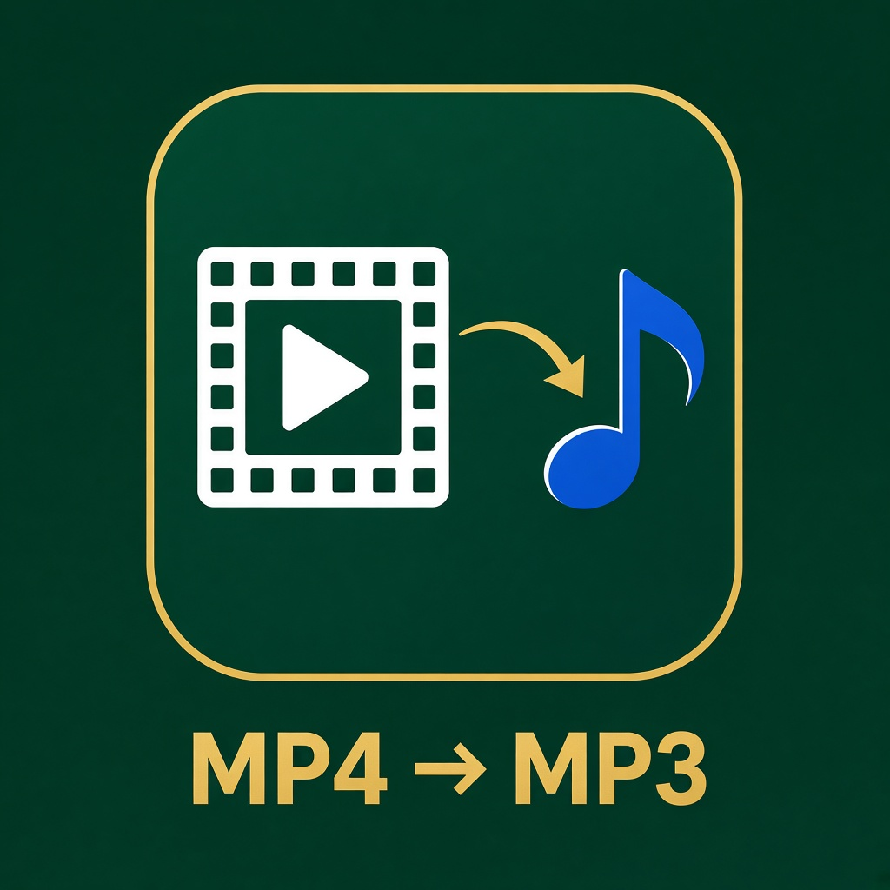

# MP4 to MP3 Converter

A free MP4 to MP3 converter for Windows. No ads, no popups, no sign-up, no uploads, no file size limits. It runs completely offline on your own PC.

## Download

**[Download MP4-to-MP3.zip (free)](https://github.com/morgankhan04/mp4-to-mp3-converter/releases/latest/download/MP4-to-MP3.zip)**

Works on Windows 10 and 11 (64-bit).

## How to use

1. Right-click the zip, choose **Extract All**, and open the folder.
2. Double-click **MP4-to-MP3.bat**.
3. Drag one or more videos into the window and press **Enter**.

A progress bar shows how far along each file is. Each MP3 is saved next to its video with the same name, and File Explorer opens with it selected when it's done.

- Converts MP4, M4V, MOV and MKV.
- Top-quality MP3 (variable bitrate, about 245 kbps).
- Your original videos are never changed.
- If Windows shows "Windows protected your PC", click **More info** then **Run anyway**. It appears because the script isn't signed.

## What's inside

All the app's code is right here in this repository and is short enough to read: `MP4-to-MP3.bat` opens `Converter.ps1`, which does the work. The conversion itself is done by [FFmpeg](https://ffmpeg.org), the free open-source audio and video engine, included in the download as `ffmpeg.exe`.

## License

The converter scripts are MIT licensed (see `LICENSE`). The included `ffmpeg.exe` is FFmpeg, licensed under the GPL; its license is in `FFmpeg-LICENSE.txt` in the download, and its source code is available from [ffmpeg.org](https://ffmpeg.org/download.html) and the [BtbN FFmpeg builds](https://github.com/BtbN/FFmpeg-Builds) it came from.
